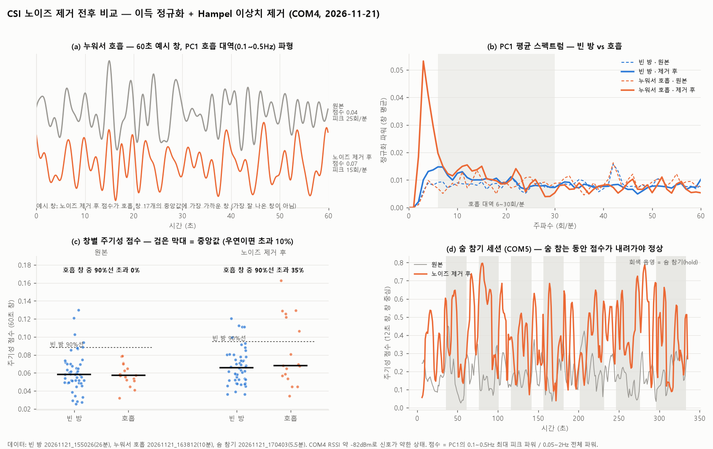
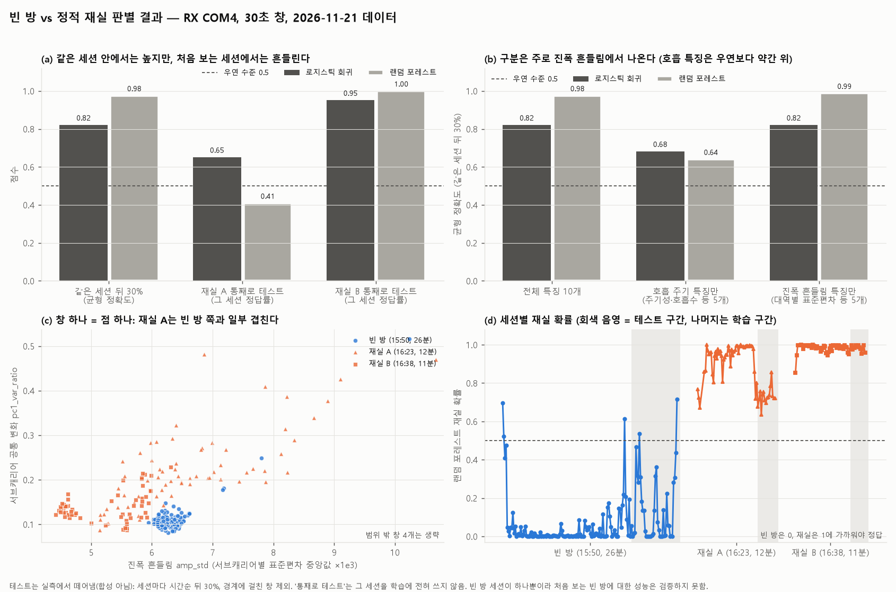

# 결과 정리 — ESP32 Wi-Fi CSI 재실·호흡 감지 PoC

> 기간: 2026-10-27 ~ 2026-11-21 · 기준 커밋: `main` · 작성 기준: 실제 로그에서 계산한 수치만 사실로 적고, 해석은 **(추정)** 으로 표시

## 한눈에 보기

| 질문 | 답 (현재 데이터 기준) |
|---|---|
| ESP32 두 대로 CSI를 안정적으로 모을 수 있나? | **예.** TX 50Hz + RX 921600bps에서 시리얼 손상 0, RX 내부 손실(`queue_drop`) 0, 무선 손실 약 2~7% |
| 빈 방과 누워 있는 사람을 구분할 수 있나? | **같은 세션 안에서는 예**(균형 정확도 0.82~0.98). **처음 보는 세션에서는 흔들림**(그 세션 정답률 0.41~1.00) |
| 그 구분이 "호흡"에서 나오나? | **아직 아님.** 구분은 주로 진폭 흔들림 차이(빈 방이 더 흔들림)에서 나오고, 호흡 주기 특징은 우연보다 약간 위(0.64~0.68) |
| 숨 멈춤을 감지할 수 있나? | **아직 아님.** 숨 참는 구간의 주기성 점수가 내려가지 않음 |
| 가장 큰 한계 | 빈 방 세션 1개·재실 세션 2개뿐. COM4 신호가 약함(RSSI −80~−84 dBm) |

---

## 1. 시스템과 확정 설정

```
[TX ESP32] ──ESP-NOW 브로드캐스트 50Hz, ch11 HT40−──▶ [RX ESP32 ×2] ──USB 시리얼 921600──▶ [PC 로거]
```

| 항목 | 값 | 근거 |
|---|---|---|
| 송신 | ESP-NOW 브로드캐스트, **50Hz**, 채널 11, HT40−, MCS0, MAC `1a:00:00:00:00:00` | 4절 |
| 송신 주기 방식 | `vTaskDelayUntil` (원본 `usleep`은 실제 91Hz) | 2절 |
| RX 시리얼 | **921600bps**, 전체 CSI 384B(192 서브캐리어) | 2절 |
| RX 보드 | ESP32-D0WD-V3 rev v3.1 ×2 (`b4:bf:e9:fa:e3:08`, `30:76:f5:92:c2:64`) | 부팅 로그 |
| PC | `csi_logger.py` → `preprocess.py` → `features.py` → `train.py` | 7절 |

## 2. 수집 시스템 실험 (통신 품질)

| 날짜 | 설정 | 보드 수신 | 무선 손실(STATS) | `queue_drop` | 시리얼 손상 | 판단 |
|---|---|---|---|---|---|---|
| 10/27 | csi_recv 예제, 921600 | 68.9Hz | (24.8%, id 기준) | 측정 안 함 | — | 콜백 안에서 출력 → 수신 누락 |
| 10/27 | firmware/rx, 921600 | 71.5Hz | (21.3%, id 기준) | 측정 안 함 | 0.08% | **시리얼 대역폭 부족**(1.3KB × 91Hz ≈ 1.19Mbps 필요) |
| 11/13 | firmware/rx, **2M** | 64.4Hz | 28.7% | **0** | **11.3%** | 병목은 풀렸지만 PC 수신에서 바이트가 빠짐 |
| 11/13 | 2M, 보드 재배치 | 85.4Hz | 6.05% | 0 | 약 11% | 무선 손실은 배치·RSSI 영향이 큼 |
| 11/13 | 2M, **TX 100Hz**(`vTaskDelayUntil`) | 93.7Hz | 6.31% | 0 | 약 11% | TX 100.00Hz 확인 |
| 11/13 | **921600 + TX 50Hz** | 48.2Hz | 3.65% | 0 | **0 / 5,773행** | **확정** |
| 11/21 | 921600 + 50Hz, **RX 2대 동시** | 47.9 / 47.8Hz | 4.07 / 4.38% | 0 / 0 | 0 / 0 | 두 RX가 같은 `id`로 정렬, 둘 다 받은 패킷 92.8%, 하나라도 98.7% |

### 수집 과정에서 찾은 문제와 해결

| 문제 | 원인 | 해결 |
|---|---|---|
| 수신 71Hz에서 막힘 | 921600bps에 전체 CSI 91Hz가 안 들어감 | 2M 시도 → 손상 때문에 **50Hz + 921600**으로 확정 |
| 2M에서 CSI 행 11% 손상 | PC 수신에서 1~2바이트씩 빠짐. 부하를 늘려도 비율이 같음 → CH340 수신 단계로 추정 | 921600으로 되돌림, 로거가 손상 행을 거름 |
| TX가 100Hz가 아니라 91Hz | `usleep(10ms)` + 송신 처리 시간 | `vTaskDelayUntil`로 정확히 100.00 / 50.00Hz |
| 손상된 헤더가 열 이름으로 들어가 CSV가 깨짐 | 로거가 헤더를 검증하지 않음 | 알려진 형식만 인정, 정수 배열 형식·값 개수 검증 |
| 무선 손실이 4%~29%로 들쭉날쭉 | 배치·RSSI 차이 (RSSI −65에서 28%, −50에서 4%) | 배치 고정, 수집 전 2분 품질 점검 |
| 빈 방 세션 중 RX 하나가 "꺼짐" | 보드는 정상인데 그 세션만 시리얼 글자가 바뀌는 손상 98% | 수집 전 두 RX 수신률 확인 절차 |
| 새 보드가 응답 없음 / 부팅 반복 | 공장 ESP-AT 펌웨어, 깨진 플래시 | `erase-flash` 후 RX 펌웨어 |
| `COM4.csv`를 git이 못 읽음 | `COM4.`은 Windows 예약 장치 이름 | 저장 이름을 `COM4_csi.csv`로 변경 |

## 3. 데이터

| 세션 | 내용 | RX | 길이 | 쓸 수 있는 구간 | RSSI (COM4 / COM5) |
|---|---|---|---|---|---|
| `20261121_155026` | 빈 방 | COM4 (COM5는 시리얼 손상) | 29분 | empty 26.0분 | −83.9 / — |
| `20261121_162338` | 가만히 누운 재실 (라벨은 나중에 수정, `pc/label_overrides.csv`) | COM4, COM5 | 12분 | static 11.9분 | −83.1 / −67.4 |
| `20261121_163812` | 누워서 자연 호흡 + 휴대폰 가속도 | COM4, COM5 | 11분 | static 10.8분 | −82.0 / −67.1 |
| `20261121_170403` | 숨 참기 7회(25~37초) + 자연 호흡 | COM4, COM5 | 5.7분 | hold 2.6분, static 1.6분 | −80.5 / −68.7 |

- 공유용 압축본: `dataset/` (breath, hold, 50Hz 기준 세션, 29MB). 빈 방·재실 A 세션은 `data/`에만 있음.
- 용량: RX 1대당 약 220MB/시간(50Hz, 실측).

## 4. 호흡 신호 분석



| 시도 | 결과 |
|---|---|
| 호흡 대역(0.1~0.5Hz) 진폭 크기 비교 | 빈 방 1.46 vs 재실 1.66, 분포가 크게 겹침 → 구분 안 됨 |
| 주기성 점수(PC1의 호흡 대역 피크 집중도) | 빈 방 0.09 vs 재실 0.10 → 구분 안 됨 |
| **노이즈 제거**: 패킷별 이득 정규화 + Hampel | 재실 창 중 빈 방 상위 10%를 넘는 비율 **0% → 35%**(우연이면 10%). ESP32는 AGC 이득 보정이 없어서 정규화 효과가 가장 큼 |
| 이동평균 추가 | 오히려 나빠짐 → 뺌 |
| 라벨 경계·창 가장자리 잘라내기 | 효과 거의 없음 (초과 비율 31~40%) |
| 휴대폰을 배 위에 올려 정답값 기록 | "가속도(g 제외)"라 호흡수가 창마다 9~30회로 흔들려 정답값으로 쓰기 어려움 |
| 숨 참기 감지 (12초 창) | 숨 참는 동안 점수가 **내려가지 않음** (hold 0.35~0.40 vs 호흡 0.23~0.46) |

(추정) 호흡 성분이 잡음보다 많이 작음. 가장 유력한 원인은 약한 신호(COM4 RSSI −80 dBm대). 같은 날 RSSI −50 dBm 배치(11/13)에서는 호흡 분석을 하지 않았음.

## 5. 재실 판별 모델



- 입력: COM4, 30초 창(10초 간격), 특징 10개 (`pc/features.py`)
- 모델: 로지스틱 회귀, 랜덤 포레스트 (`pc/train.py`)
- **테스트 데이터는 실측에서 떼어냄(합성 아님)**: 세션마다 시간순 뒤 30%, 경계에 걸친 창 제외

| 평가 | 로지스틱 회귀 | 랜덤 포레스트 | 기준선 |
|---|---|---|---|
| 같은 세션 뒤 30% (균형 정확도) | 0.821 | **0.976** | 0.500 |
| 재실 A를 학습에서 통째로 빼고 그 세션 정답률 | 0.65 | **0.41** | — |
| 재실 B를 학습에서 통째로 빼고 그 세션 정답률 | 0.95 | 1.00 | — |
| 학습에 안 쓴 숨 참기 세션(사람 있음) 30초 창 32개 (재실 A 라벨 수정 전 모델) | 100% static | 100% static | — |

| 특징 묶음 (같은 세션 뒤 30%) | 로지스틱 | 랜덤 포레스트 |
|---|---|---|
| 전체 10개 | 0.82 | 0.98 |
| 호흡 주기만 (주기성·호흡수·대역 비율·엔트로피·자기상관) | 0.68 | 0.64 |
| 진폭 흔들림만 (대역별 표준편차·PC1 분산비) | 0.82 | 0.99 |

랜덤 포레스트 특징 중요도: `motion_std` 0.29, `amp_std` 0.23, `pc1_var_ratio` 0.16, `slow_std` 0.13, `breath_std` 0.09, 나머지 0.04 이하.

### 해석
- 모델은 **"빈 방이 사람이 있을 때보다 진폭이 더 흔들린다"** 는 차이를 주로 쓴다. 사람이 TX–RX 사이에 누워 있으면 다중 경로가 바뀌어 신호가 안정되는 것일 수 있음 **(추정)**.
- 같은 세션 안의 점수는 낙관적이다. 처음 보는 재실 세션에서 0.41~1.00으로 흔들린다.
- **빈 방 세션이 하나뿐**이라 "처음 보는 빈 방"에 대한 성능은 검증하지 못했다. 빈 방(15:50)과 재실(16:23 이후)의 측정 시간대가 달라, 모델이 시간대·배치 차이를 배웠을 가능성을 배제하지 못한다.
- 빈 방 세션의 시작·끝에서 재실 확률이 0.5~0.7로 튐 → 사람이 드나든 구간이 라벨 경계 3초 제외로는 다 빠지지 않은 것으로 보임 **(추정)**.

## 6. 한계와 향후 방향

| 한계 | 향후 방향 |
|---|---|
| 클래스마다 세션 1~2개, 빈 방과 재실이 다른 시간대 | **한 세션 안에 빈 방·재실을 번갈아** 수집(예: 5분씩), 여러 날·여러 배치 반복 → 세션 단위 교차 검증 |
| COM4 RSSI −80 dBm대로 약함 | 두 RX 모두 RSSI −60 dBm 이상이 되도록 배치(거리 2~3m, 마주 보게) 후 수집 |
| 호흡 특징이 약함 | 위상 정보 사용(선형 성분 제거 후 위상 차), 서브캐리어 선택, 메트로놈 호흡으로 정답값 확보 |
| 숨 멈춤 감지 실패 | 신호 세기 개선 후 재시도. 장시간 "재실 + 호흡 없음"은 사람 대신 물을 채운 통 등으로 재현 검토 |
| 휴대폰 정답값이 약함 | "가속도(g 포함)" 또는 기울기 센서로 기록, 시작·끝 3회 두드림으로 싱크 |
| 상태 머신·알림 미구현 | 재실 판별 → 활동/정적 재실 → 이상 의심(N분) 순서로 규칙 기반부터 |

## 7. 재현 방법

```powershell
cd E:\esp\wifi-sensing\pc
pip install -r requirements.txt
python rx_stats.py ..\data\<세션>\*.csv                        # 수신 품질
python preprocess.py ..\data\2026112* ..\dataset\*            # → ..\processed\<세션>\<RX>.npz
python features.py --win 30 --step 10                         # → ..\processed\features_win30s.csv
python train.py                                               # 같은 세션 뒤 30% 테스트
python train.py --test-sessions 20261121_162338               # 세션 통째로 테스트
python plot_results.py                                        # → ..\docs\figures\model_results.png
python plot_denoise.py                                        # → ..\docs\figures\denoise_compare.png
```

| 파일 | 역할 |
|---|---|
| `firmware/tx`, `firmware/rx` | 송신·수신 펌웨어 (각 README에 측정 기록) |
| `pc/csi_logger.py` | 시리얼 수집, 손상 행·헤더 검증, STATS 저장 |
| `pc/rx_stats.py` | 수신 품질 요약 |
| `pc/csi_io.py` | CSI 읽기, 노이즈 제거, 호흡 주기성 점수 |
| `pc/preprocess.py`, `pc/label_overrides.csv` | 전처리, 측정 뒤 라벨 수정 |
| `pc/features.py`, `pc/train.py` | 창 특징, 모델 학습·평가 |
| `pc/plot_results.py`, `pc/plot_denoise.py` | 이 문서의 그림 |
| `dataset/` | 공유용 세션 (공개) |
